# Long-Form Video Pipeline

**From topic research to a ready 2-hour DaVinci Resolve timeline, automatically.**

I built this for a YouTube channel *Cosmos Decoded / Sleep on Galaxy*, which makes 2-hour calm space documentaries.
Editing one video by hand took many hours. Now I give it a script, a voiceover and music, and it builds the whole
1440p timeline in DaVinci Resolve (free version): footage, transitions, colour, voice and music.

> 🎬 **Demo video:** *(add your link here)*

---

## How it works

```mermaid
flowchart LR
    A[Topic research<br/>topic_research/] --> B[Script + TTS voice]
    B --> C[Find pauses<br/>in the voice]
    C --> D[Plan scenes<br/>scenes.csv]
    D --> E[Search & download<br/>Pixabay footage]
    E --> F[Quality filter<br/>brightness, greenscreen,<br/>daytime, blank frames]
    F --> G[Build shots<br/>cut only at pauses]
    G --> H[Audio mix<br/>deep voice + music<br/>ducking + loudness]
    H --> I[FCPXML timeline<br/>+ colour correction]
    I --> J[Lua script builds<br/>timeline in Resolve]
    J --> K[1440p render]
```



1. **Topic research** (`topic_research/`): uses the YouTube Data API to find which videos in the niche are beating their channel's normal views, and turns that into topic ideas.
2. **Pause detection**: FFmpeg `silencedetect` finds the natural pauses in the voiceover, so clips only change between sentences.
3. **Scene planning**: the script is split into scenes, each with a search keyword (editable in `scenes.csv`).
4. **Footage search**: clips are searched on Pixabay (NASA sources optional), with tag bans for games, simulations, people, telescopes and landscapes.
5. **Quality filter**: every clip is sampled frame-by-frame and rejected if it is too bright, daytime, greenscreen, blank, low-resolution, 10-bit, or has an odd frame rate.
6. **Shot building**: 8–25 second shots, aligned to voice pauses, with a dip to black between clips and no clip repeated too soon.
7. **Audio**: the voice is made deeper and softer; several music tracks are volume-matched, shuffled and crossfaded, and dip under the voice (sidechain ducking); final loudness is normalized.
8. **Timeline**: an FCPXML file plus colour-correction values are written, and a Lua script imports it into DaVinci Resolve and renders the video.

## Features

- Script + voice + music → finished 2-hour timeline
- Clip changes only at pauses in the narration
- Dip-to-black transitions and a slow fade at the end
- Automatic colour correction (cool / neutral / warm looks)
- Deep, soothing voice processing
- Multi-track music with crossfades and ducking
- Clip quality checks + a `blocklist.txt` to ban any bad clip forever
- Clip library that is reused across videos (saves downloads)
- Works with the **free** DaVinci Resolve

## Tech stack

| Part | Tools |
|---|---|
| Main pipeline | Python 3 |
| Audio / video processing | FFmpeg, ffprobe (silencedetect, rubberband, sidechaincompress, acrossfade, loudnorm) |
| Footage | Pixabay API (NASA SVS / NASA Images optional) |
| Timeline | FCPXML 1.9 |
| Resolve automation | Lua (DaVinci Resolve scripting API) |
| Research | YouTube Data API v3, optional Gemini |
| Windows launchers | Batch files |

## Project structure

```
longform-video-pipeline/
├── sleep_editor.py              # the whole video pipeline
├── 0_topic_research.bat         # step 0: research topics
├── 1_plan_scenes.bat            # step 1: plan scenes from the script
├── 2_make_video.bat             # step 2: footage, audio, timeline
├── 3_update_resolve_scripts.bat # reopen an older episode in Resolve
├── config.example.json          # settings template (copy to config.json)
├── blocklist.txt                # clip IDs that must never be used
├── resolve_scripts/             # example Lua scripts that run inside Resolve
├── input/                       # put script, voice and music here
│   ├── script/
│   ├── voice/
│   └── music/
└── topic_research/              # finds winning topics (YouTube Data API)
```

Created automatically when you run it (not in the repo): `episodes/`, `library/`, `config.json`.

---

## Setup (Windows)

1. Install **Python 3**, **FFmpeg** (added to PATH) and **DaVinci Resolve** (free).
2. Install the Python package:
   ```
   pip install -r requirements.txt
   ```
3. Copy `config.example.json` to `config.json` and paste your free [Pixabay API key](https://pixabay.com/api/docs/).
4. For topic research, follow `topic_research/README.md`.

## Making a video

1. Put your files in `input/` (any file names):
   - `input/script/`: one narration script (.txt)
   - `input/voice/`: one voiceover (mp3, wav, m4a…)
   - `input/music/`: all background music tracks
2. Double-click **`1_plan_scenes.bat`**, type an episode name. Edit the `query` column in `scenes.csv` if you like.
3. Double-click **`2_make_video.bat`** with the same name. Wait for **Done!**
4. Open DaVinci Resolve, open any project, run **Workspace › Scripts › SleepEditor_Build** (F6 shows progress).
5. Check the timeline, then run **Workspace › Scripts › SleepEditor_Render**. The video is saved in `episodes/<name>/render/`.

Footage and music credits for the video description are written to `episodes/<name>/credits.txt`.

## Settings (`config.json`)

| Setting | What it does |
|---|---|
| `transition_style` | `"black"` (dip to black) or `"dissolve"` |
| `voice_pitch` | 0.92 deeper … 1.0 unchanged |
| `music_level` | background music volume |
| `color_look` | `"cool"`, `"neutral"` or `"warm"` |
| `shot_min_seconds` / `shot_max_seconds` | how often clips change |
| `max_brightness` | quality filter brightness limit (lower = darker) |
| `width` / `height` | output size (2560×1440 by default) |
| `sources` | `["pixabay"]`, can add `"nasa_svs"`, `"nasa_images"` |

---

## Problems I solved along the way

- **Free Resolve has no Python scripting** (and Python 3.14 isn't detected): switched to Lua. Lua inside Resolve has no file access, so the Python side generates the Lua scripts with all values built in.
- **2-hour timelines failed to import** while 3-minute ones worked: tracked it down to (1) a truncated audio file when a key press stopped FFmpeg, (2) hidden start timecodes in some downloaded clips, (3) unusual frame rates like 31.25 fps. Each is now detected and fixed or rejected automatically.
- **One episode would not load at all**: a single 10-bit H.264 clip. Free Resolve can't read 10-bit H.264, so 10-bit clips are now rejected on download and converted to 8-bit if already in the library.
- **Bad footage** (game footage, daytime sky, greenscreen telescope shots): added tag bans plus a frame-sampling quality check, measuring brightness, dark-area ratio, green-screen ratio and flat frames.
- **Starfields marked as "blank"**: averaging pixels erased the stars, so the check now samples individual pixels instead.
- **Music and voice balance**: tracks are normalized once and cached, crossfaded into one playlist, and the music dips under the voice with sidechain compression.

## Author

**Mango**

## License

MIT, see [LICENSE](LICENSE).
